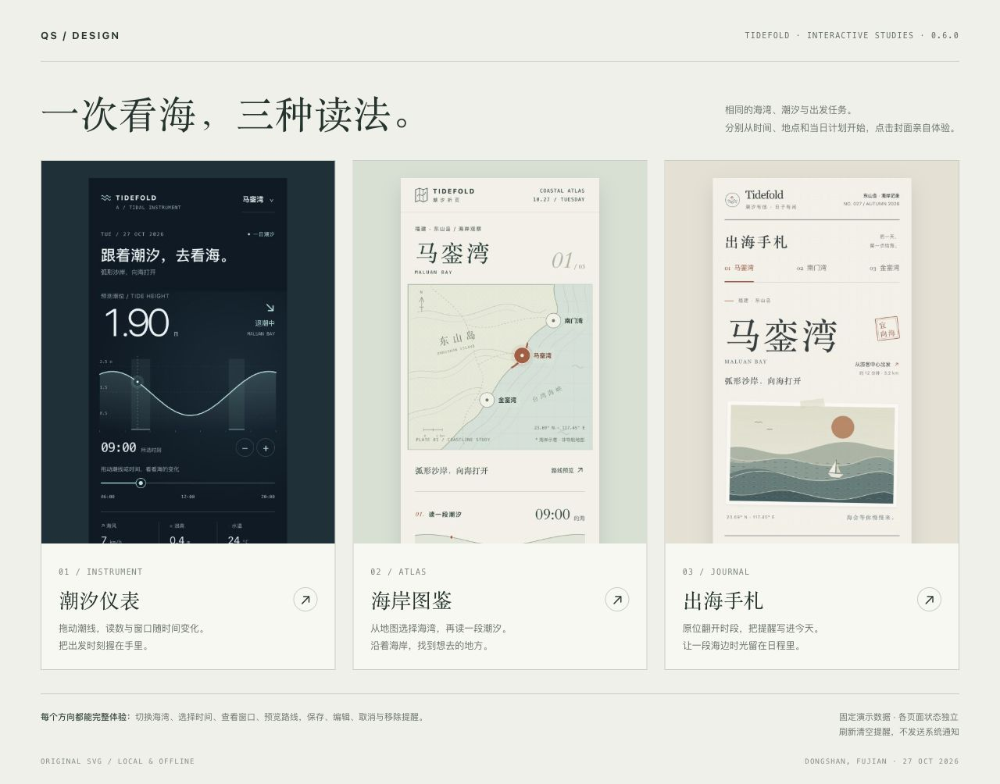

  

<h1 align="center">QS Design</h1>

为 iPhone 和 iPad 设计有主题、有细节、能真正操作的页面。

## qs-ios-design · 0.6.0

从用户任务与真实内容出发，独立形成主题，为功能模块选择合适的结构，再把视觉与交互一起实现。

- 多方向使用同一份任务和数据，分别决定产品解释、视觉主角与主要操作。
- 模块根据时间、地点、比较、组织和输入等关系设计，通过一致的视觉语言组成页面。
- 参考库包含 117 个来源条目、55 个案例与选材配方，覆盖产品流程、中文排印、原生与网页交互、原创作者、素材、领域数据和社区反馈。按问题读取，允许继续搜索或不用现有范例。
- 草稿、保存、取消、返回和连续输入随原型制作；可选行为工具不包含视觉模板。
- Light/Dark 按需求与产品场景决定。日常工作不设置评分、审计或固定审批轮次。

## 体验 Tidefold

先把仓库放到本机，直接打开 [原型总览](ios-design/showcase/index.html)，点击封面进入三个独立页面。GitHub 中的 HTML 链接显示源码，需要下载后打开；本仓库未提供托管预览地址。

| 方向 | 体验重点 |
|---|---|
| [潮汐仪表](ios-design/showcase/tidefold-prototype.html) | 调整时间，潮线读数与推荐窗口同步变化。 |
| [海岸图鉴](ios-design/showcase/tidefold-atlas.html) | 点选海岸地点，以地图与地方信息组织海况。 |
| [出海手札](ios-design/showcase/tidefold-journal.html) | 原位展开时段，把提醒写进今日行程。 |

三者都支持切换海湾、选择时间、查看窗口与路线，以及提醒保存、编辑、取消、移除和重置。数据与路线为固定演示；提醒保存在当前页面内存，刷新清空，不会发送系统通知。图形均为原创 SVG/CSS，无远程字体或 CDN 依赖。每个打包后的原型 HTML 可独立打开。

[案例与实现说明](ios-design/references/examples/tidefold.md) · [资料入口](ios-design/references/source-registry.md) · [案例索引](ios-design/references/examples/index.md)

## 安装

需要 Node.js 22.20 或更高版本。选择自己使用的工具执行：

### Codex

~~~bash
npx skills add yuanqishen666/QS-Design --skill qs-ios-design -g -a codex -y
~~~

### Cursor

~~~bash
npx skills add yuanqishen666/QS-Design --skill qs-ios-design -g -a cursor -y
~~~

### Claude Code

~~~bash
npx skills add yuanqishen666/QS-Design --skill qs-ios-design -g -a claude-code -y
~~~

安装完成后重新打开工具或开始新会话。这些命令从 GitHub 安装远程版本；本机未推送的改动不会通过远程命令安装。

## 使用

~~~text
用 $qs-ios-design 给我的 iPhone 记账 App 设计一个能单手快速记录的首页。
~~~

可以附上现有截图、产品说明或 SwiftUI 工程。信息明确时直接开始，仅在关键歧义影响结果时询问。

## 维护示例

修改 showcase/src 中的源文件后重新生成单文件原型：

~~~bash
node ios-design/scripts/package-prototype.mjs --showcase
node --test ios-design/scripts/prototype.test.mjs
~~~

无需依赖安装。测试覆盖共享行为和打包器，属于维护工具时的开发验证，不是每次使用 skill 必须执行的设计审计。打包器支持范围见 [交付说明](ios-design/references/prototype-output.md)。
