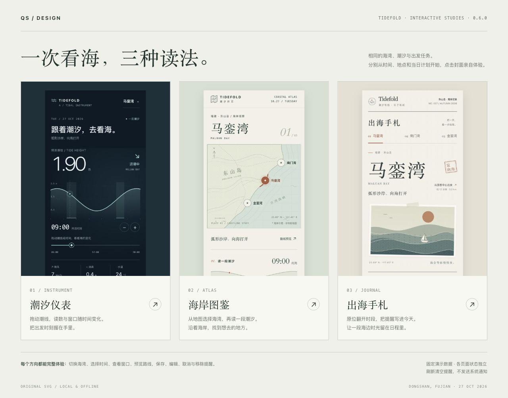

<p align="center">
  <a href="https://htmlpreview.github.io/?https://github.com/yuanqishen666/QS-Design/blob/main/ios-design/showcase/index.html"></a>
</p>

<h1 align="center">QS Design</h1>

<p align="center">从模糊业务语言形成业务特异、视觉优秀、跨平台原生且可验证的产品体验。</p>

## 看看效果

点击上面的设计稿，或者直接[打开 Tidefold 原型](https://htmlpreview.github.io/?https://github.com/yuanqishen666/QS-Design/blob/main/ios-design/showcase/index.html)。里面有三套完整方向，每一套都可以实际操作。

还可以查看[设计样张库](https://htmlpreview.github.io/?https://github.com/yuanqishen666/QS-Design/blob/main/specimens/index.html)和[行为实验室](https://htmlpreview.github.io/?https://github.com/yuanqishen666/QS-Design/blob/main/specimens/behavior-lab/index.html)。样张按布局、内容压力、视觉材料、交互行为、跨平台翻译和降级方式组织，不是固定风格菜单。

## 它能做什么

- 把设计任务而不是项目文件夹作为上下文根；纯聊天出图与已有产品增量设计都能工作。
- 只使用一个 `$qs-design` 入口，内部按 iOS、Android、Web、微信和支付宝的真实能力自动分流。
- 用 Task Capsule 隔离拒绝稿和未授权历史，只继承用户明确点名的候选方面。
- 根据真实不确定性探索一至三个方向，不靠固定三案或换色制造选择。
- 从业务对象、关系、状态、风险和价值时刻形成页面拓扑、视觉主角和标志性交互。
- 用连续性契约决定现有产品的哪些部分保留、适配、开放或禁止。
- 让布局、视觉层级、间距、真实数据和清晰操作先完成解释，不为每个区块机械添加说明。
- 关键金额、权限、风险、格式、后果和恢复保持可见；tooltip 只承载简短、可选、非交互信息。
- 检查键盘、触控、读屏、文字缩放、减弱动态、异常、性能、素材来源和平台降级。

## 3.2 内容显隐改造

辅助文案现在必须说明它承担的业务目的、不可替代事实、受众、出现时机和显隐方式，同时记录为什么布局、状态或控件不能独立表达。静态检查会发现重复说明模板、缺失可见标签、危险 tooltip、无焦点触发器和内容契约漂移；运行验证则分别报告解释依赖、关键事实可见性、披露输入等价性与误删风险，不以字数或“极简感”打分。

## 安装和使用

需要 Node.js 22.20 或更高版本。整个项目只安装一个 `qs-design` skill，共享内核、平台适配、交互实验和审计工具都会一起安装。选择自己使用的工具，执行一条命令即可。

### Codex

```bash
npx skills add yuanqishen666/QS-Design --skill qs-design -g -a codex -y
```

### Cursor

```bash
npx skills add yuanqishen666/QS-Design --skill qs-design -g -a cursor -y
```

### Claude Code

```bash
npx skills add yuanqishen666/QS-Design --skill qs-design -g -a claude-code -y
```

已经安装旧版 `qs-ios-design` 的用户，可以先移除旧入口，再安装上面的新版：

```bash
npx skills remove qs-ios-design -g -a codex -y
```

以后更新只需要运行：

```bash
npx skills update qs-design -g -y
```

安装完成后，重新打开工具或开始一个新会话。所有平台都使用 `$qs-design`，在需求中写清平台即可：

```text
用 $qs-design 给我的记账产品设计 iOS、Android 和 Web 三端首页。
```

单个平台也使用同一个入口，例如“用 `$qs-design` 设计微信小程序会员首页”。总控会自动选择平台适配器；也可以附上现有截图、产品说明或工程。信息够用时会直接开始设计，只有关键内容不明确时才会提问。
