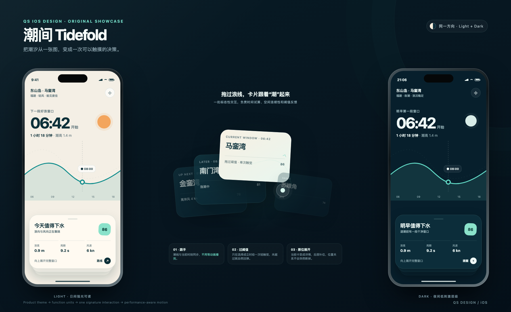

<p align="center">
  
</p>

<h1 align="center">QS Design</h1>

<p align="center">
  为 iPhone 和 iPad 设计好看、好用、能真实点击的原生界面。
</p>

## qs-ios-design

`qs-ios-design` 会先理解产品在做什么，再完成页面结构、视觉风格、交互和动效设计。它既可以从零设计一款 App，也可以读取现有截图、产品说明或 SwiftUI 工程，在保留原有功能的基础上继续设计。

- 从产品主题出发确定版式、颜色、字体、图像、材质和动效，让每款 App 有自己的视觉性格。
- 首页、搜索、学习、详情、设置等功能会分别设计，再用统一的视觉语言连成完整产品。
- 需要探索时会提供 2–3 个完整方向。每个方向都保留同一份功能，并拥有不同的视觉主角、布局和标志性交互。
- 每个方向默认同时提供 Light 与 Dark，两种模式属于同一套设计。
- 动效会贯穿按压、选中、展开、拖拽、保存、返回和完成状态，让页面之间的变化自然连贯。
- 样板图会连接可点击原型，主要 Tab、卡片、按钮和功能页都可以实际操作。
- 页面文案简短自然，交付内容只保留原型、方向说明和使用入口。

## 设计示例

上面的「潮间 Tidefold」是一款查看潮汐与下水时段的 iOS 概念。潮线是首页的主要交互：拖动它可以查看下一段适合下水的时间，松手后当前海滩卡片会展开，后面的地点顺势补位。

浅色与深色模式使用同一套信息结构和几何语言，并分别处理了海面亮度、文字对比和材质层次。

## 安装

需要 Node.js 22.20 或更高版本。选择自己使用的工具，执行一条命令即可。

### Codex

```bash
npx skills add yuanqishen666/QS-Design --skill qs-ios-design -g -a codex -y
```

### Cursor

```bash
npx skills add yuanqishen666/QS-Design --skill qs-ios-design -g -a cursor -y
```

### Claude Code

```bash
npx skills add yuanqishen666/QS-Design --skill qs-ios-design -g -a claude-code -y
```

安装完成后，重新打开工具或开始一个新会话。

## 使用

直接描述产品和需要设计的页面：

```text
用 $qs-ios-design 给我的 iPhone 记账 App 设计一个能单手快速记录的首页。
```

也可以附上现有截图、产品说明或 SwiftUI 工程。信息明确时会直接开始设计；遇到会明显改变结果的问题时，才会询问必要信息。
