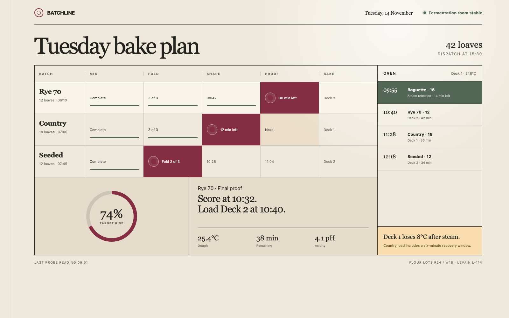
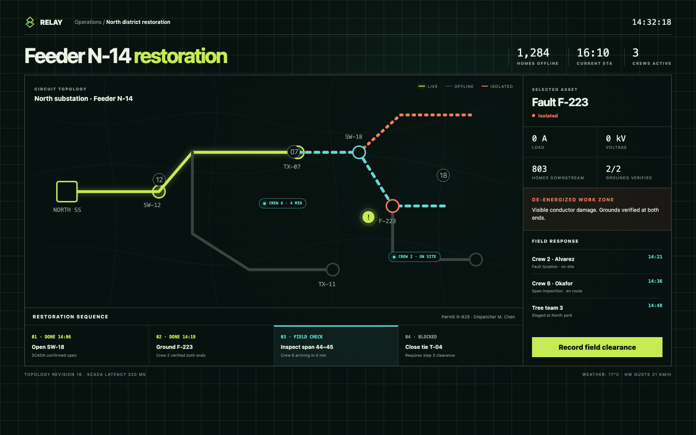
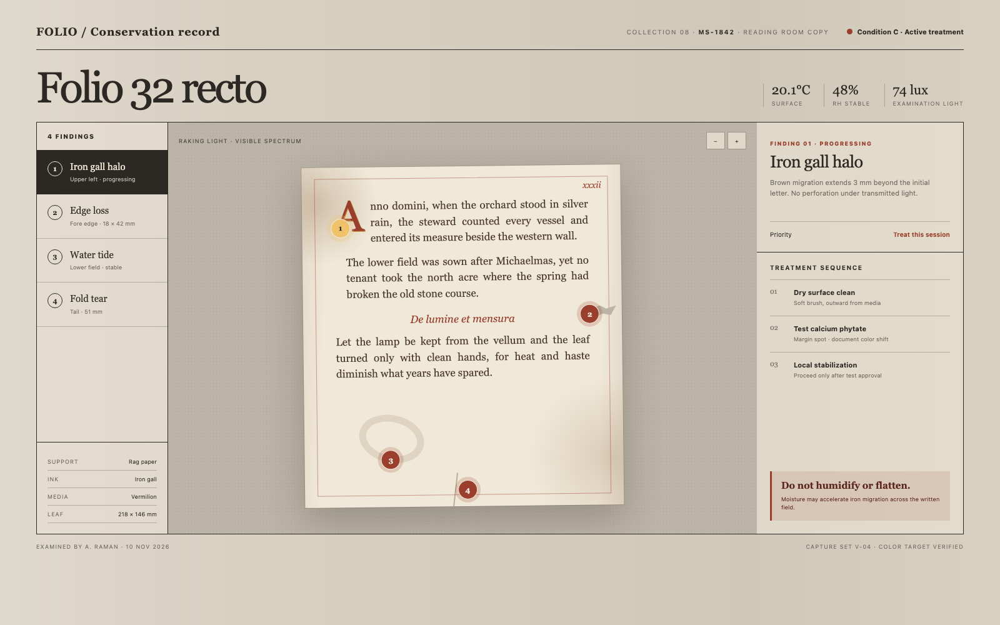

<h1 align="center">QS Design</h1>

<p align="center">面向编码智能体的业务条件化、上下文隔离产品设计能力。</p>

<p align="center"><a href="./README.md">English</a> · <strong>简体中文</strong></p>

QS Design 把模糊业务语言转化为业务特异、平台原生且可验证的产品体验。它把设计任务而不是项目文件夹作为上下文根，因此既能在纯聊天中完成概念设计，也能在已有产品中进行增量设计与重构。

## 设计展示

以下示例不共享一套视觉模板。每个界面都由自己的核心对象、状态变化、工作节奏和风险推导而来。克隆仓库后，可在浏览器中打开 [`showcase/index.html`](./showcase/index.html) 查看可交互页面。

### Batchline · 烘焙生产

发酵阶段、面团状态和烤炉恢复时间共同决定页面拓扑。选择批次后，界面只呈现当前需要执行的实体动作和判断数据。

[可交互 HTML 源文件](./showcase/batchline.html)



### Relay · 配电抢修

馈线网络本身就是主界面。带电、隔离和现场许可状态与切换顺序、受影响住户保持空间关联。

[可交互 HTML 源文件](./showcase/relay.html)



### Folio · 手稿修复

文物本体始终处于视觉中心。病害记录绑定到纸页的准确位置，处理顺序和操作禁忌保持可见。

[可交互 HTML 源文件](./showcase/folio.html)



## 它能做什么

- 只使用一个 `$qs-design` 入口，内部按 iOS、Android、Web、微信和支付宝的真实能力自动分流。
- 无项目文件夹也能工作，同时支持已有产品的增量设计与页面重构。
- 用 Task Capsule 隔离拒绝稿和未授权历史，只继承用户明确点名的候选方面。
- 根据真实不确定性探索一至三个方向，不靠固定方案数或换色制造选择。
- 从业务对象、关系、状态、风险和价值时刻形成页面拓扑、视觉主角、核心模块与标志性交互。
- 用连续性契约决定现有产品的哪些部分保留、适配、开放或禁止。
- 让布局、视觉层级、间距、真实数据和清晰操作先完成解释，再判断是否需要辅助文字。
- 关键金额、权限、风险、限制、后果和恢复保持可见；tooltip 只承载简短、可选、非交互信息。
- 检查键盘、触控、读屏、文字缩放、减弱动态、异常、性能、素材来源和平台降级。

## 安装和使用

需要 Node.js 22.20 或更高版本。整个项目只安装一个 `qs-design` skill，共享内核、平台适配、交互实验和验证合同都会一起安装。

### Codex

```bash
npx skills add yuanqishen666/QS-Design --skill qs-design -g -a codex -y
```

### Cursor

```bash
npx skills add yuanqishen666/QS-Design --skill qs-design -g -a cursor -y
```

### Claude Code

```bash
npx skills add yuanqishen666/QS-Design --skill qs-design -g -a claude-code -y
```

已经安装旧版 `qs-ios-design` 的用户，可以先移除旧入口，再安装当前版本：

```bash
npx skills remove qs-ios-design -g -a codex -y
```

以后更新只需要运行：

```bash
npx skills update qs-design -g -y
```

安装完成后，重新打开工具或开始一个新会话。所有平台都使用 `$qs-design`，在需求中写清目标平台即可：

```text
用 $qs-design 给我的记账产品设计 iOS、Android 和 Web 三端首页。
```

也可以附上现有截图、产品说明或工程。信息足够时会直接开始设计；只有缺失内容会改变主任务或视觉方向时才会提问。
